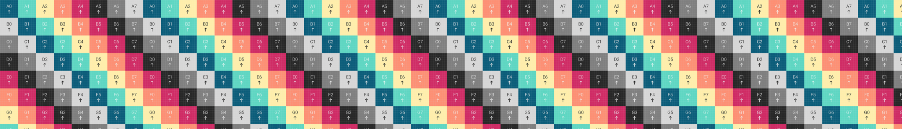

# UVScope

UVScope is a macOS app for real-time UV and texture preview on 3D meshes (OBJ/FBX) with Metal rendering.



## Download

Ready-to-use notarized builds are published in GitHub Releases.

- Latest release: [v1.0.0](https://github.com/freemansart/UVScope/releases/tag/v1.0.0)
- Direct DMG: [UVScope-mac.dmg](https://github.com/freemansart/UVScope/releases/download/v1.0.0/UVScope-mac.dmg)

## Features

- OBJ and FBX scene/model loading
- NDI, video file, or image as texture source
- Interactive camera controls with presets
- UV grid and face-side visualization tools
- Floor grid and optional venue geometry overlays
- Screenshot and H.264 recording
- Apple-notarized DMG distribution

## Requirements

- macOS (Apple Silicon / Intel)
- Xcode 16+

## Build From Source

```bash
git clone git@github.com:freemansart/UVScope.git
cd UVScope
xcodebuild -project UVScope.xcodeproj -scheme NDIPlayground -configuration Debug build
```

You can also open `UVScope.xcodeproj` in Xcode and run the `NDIPlayground` scheme.

## License

This project is licensed under the MIT License.
See [LICENSE](./LICENSE).
